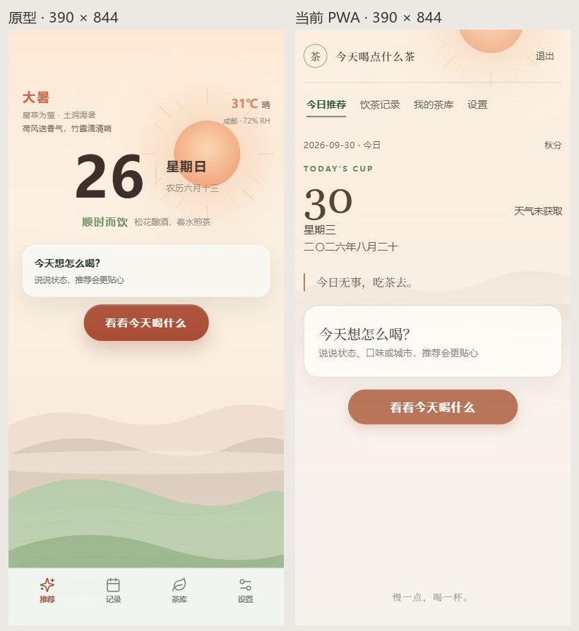
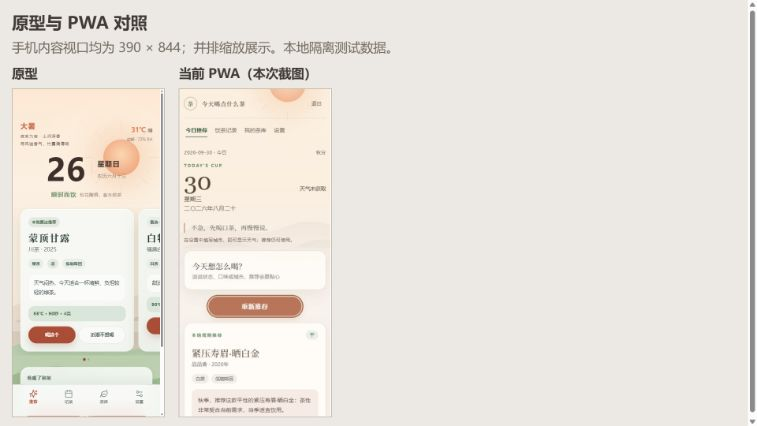
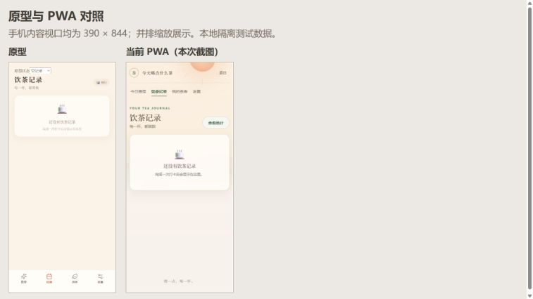
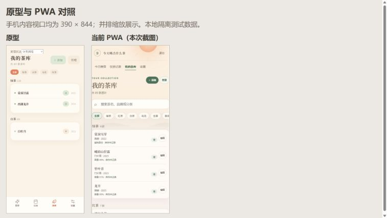
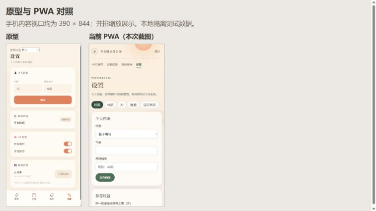
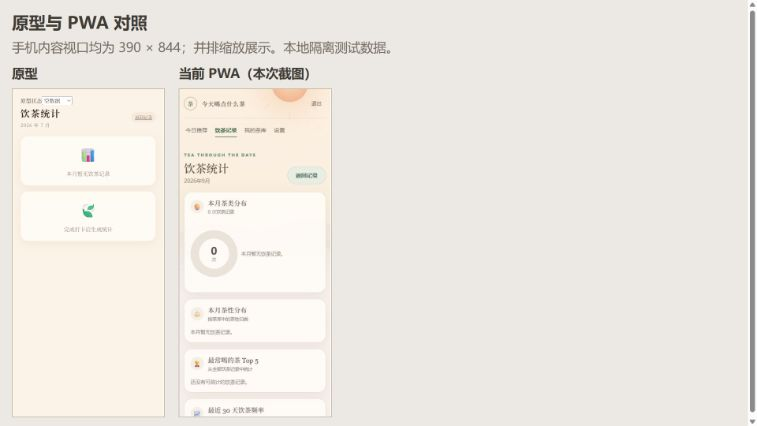
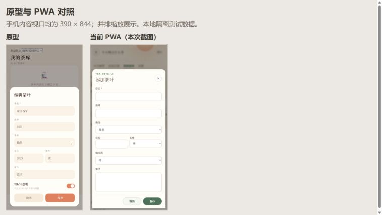
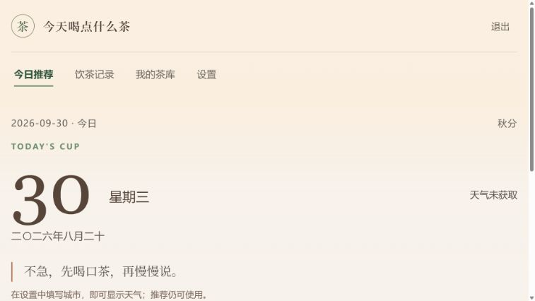

# PWA UI 还原审核

日期：2026-09-30。结论：当前 PWA 已有五页功能，但主要手机界面没有按现有原型还原，视觉验收未通过。背景资源仍在，当前渲染方式让完整风景几乎看不见。

## 范围与证据

- 基准：`ui-prototype/manifest.json`、五页 HTML、`styles/tokens.css`、`styles/components.css`、`styles/pages.css` 和原型脚本。沿用已有设计，不提出新的架构、框架或视觉方向。
- 受审版本：本地 `web/dist/`，使用临时测试密码、独立测试数据库和种子茶库。没有读取个人数据库、真实 AI Key 或用户导出文件，也没有向生产库写入。
- 通过 Workbench 以 `yang` 只读核对了 `/var/www/tea/` 的 HTML、CSS、JS：三份文件 SHA-256 与本地构建一致。因此截图对应线上发布的静态版本；数据和天气使用本地测试状态。
- 手机页面内容视口为 390 × 844。原型日期、天气和茶名为示例，与 PWA 的实际日期/种子结果不同；这些数值差异不作为还原问题。
- 内置浏览器直接访问线上域名超时，线上真实登录页面未截图。本地截图不是用户手机实机验收。桌面只抽查了 766 × 431 的首页可见区域。
- 原型中“原型状态”选择器是审核辅助控件，不属于要迁移的产品 UI。对照图右侧为本次已保存的 PWA 截图，左侧为当前运行的原型；原始 PWA 图片也保留在本目录。

发布文件核对：

| 文件 | 本地与 ECS 一致的 SHA-256 |
| --- | --- |
| `index.html` | `003e716eba9f6a2db528dfdf680a309be8ccf8516f4832cc05d5fec956caa84a` |
| `assets/index-CJLN5eAp.css` | `8e4f9ee136dfceffb87aaaf7db79d7ebef7e2f684e29cb27e90544d7bed13dfc` |
| `assets/index-BO-z4zLg.js` | `4f2e79692ae20fbadcd6d8b5116d5e81157bdb6d1215b39b8c86a39e4a89d270` |

## 1. 推荐首页：差异明显

**确认的问题：**

1. 原型是全屏固定风景；PWA 将背景放进顶部绝对定位容器。手机实测背景高约 464 px，原型约 844 px。背景源图是纵向风景，短容器的 `object-fit: cover` 会裁掉画面；底部山丘和绿色地景又被渐变盖淡。截图中 PWA 的下半屏基本只剩纯底色。
2. 原型的节气/天气、日期和短句有明确分组，输入提示紧凑。PWA 增加品牌栏、顶部导航、英文眉题，日期/星期改为上下布局，短句改为左边线引用，输入卡片也更高，推荐按钮整体下移。
3. 原型手机底部有四个图标导航；PWA 改为顶部文字导航，底部仅保留一句页脚文字。长页面滚动后，顶部导航离开可见区域。
4. 未配置天气的测试状态显示“天气未获取”，背景却显示太阳。当前 `sceneOverlay` 对空天气描述走晴天分支，容易把缺少天气数据显示成晴天。

**代码位置：** `web/src/App.vue:84`、`:85`、`:639`、`:640`、`:651`、`:653`；`web/src/style.css:3`、`:4`、`:5`、`:6`、`:7`、`:14`。对照 `ui-prototype/styles/pages.css:108`、`:279` 和 `ui-prototype/styles/components.css:74`。

**背景加载核对：** `images/base-*.svg` 和天气叠加 SVG 均在源码中；App 导入这些文件，生产构建使用内联 SVG data URI。当前页两张背景图片均 `complete=true`，自然宽度非零。`dist/assets/` 中没有单独 SVG 文件属于内联构建行为。此次本地复现的主要原因是裁剪、遮罩和页面结构，未发现当前背景图片加载失败；线上特定设备是否另有加载问题仍需实机核对。

## 2. 规则推荐结果：差异明显

- 原型主推与备选使用横向滑动卡片、露出下一张卡片及分页点。
- PWA 在手机上变为两张完整卡片纵向排列，每张实测约 412 px 高；日期、输入卡片仍占据上方空间，主推与备选需要更多滚动。
- 主操作的颜色关系改变：PWA 的“喝这个”使用深绿，原型采用暖色主操作。卡片文本层级和冲泡信息区也没有沿用原型样式。
- 功能名称、茶名、原因和冲泡信息仍可读，这是可以保留的部分。需要恢复手机轮播与既有样式，桌面按宽度展开，继续保留真实结果和操作逻辑。

**代码位置：** `web/src/App.vue:655` 附近推荐结果模板；`web/src/style.css:8`、`:14`。对照 `ui-prototype/styles/pages.css:222` 的 `.rec-track`、`:233` 的 `.rec-slide`。

## 3. 饮茶记录：基本内容在，页面外壳偏离

- 保留了“每一杯，都算数”、空态和统计入口。
- 额外的全局品牌栏、顶部导航和英文标题让记录内容下移；页面还带上了推荐页风景。原型为奶油底色、紧凑标题和底部导航。
- 本次是空记录视觉对照；非空列表、图片编辑、品饮展开等状态没有完成逐状态视觉验收。

**代码位置：** `web/src/HistoryPage.vue:303` 附近样式及标题模板；全局背景和导航仍来自 App。

## 4. 茶库：留白和信息密度问题明显

- 分类、列表、添加和管理入口存在，打开新增弹层正常。
- `.tea-library-page` 使用 `width:100%`，手机实测左侧位置为 0、水平 padding 为 0。标题、搜索框、分类栏和列表贴近屏幕边缘，与其他 PWA 页的左右留白也不一致。
- 列表新增画像覆盖率、库存摘要和每行编辑按钮，分类标记/圆点和原型的精简排列没有沿用，视觉密度和颜色层级明显改变。
- 当前抽查没有文档级横向溢出；分类条本身可水平滚动。修复应优先补统一手机留白，并保持已有画像/库存功能。

**代码位置：** `web/src/TeaLibraryPage.vue:771` 附近 `.tea-library-page`、`.tea-row`、`.tea-tags`、`.filter-pill` 样式。

## 5. 设置：页面组织改变较多

- 原型在同一页呈现个人档案、体质辨识、AI 配置和数据管理卡片。
- PWA 改成“档案 / 体质 / AI / 数据 / 运行状态”标签分区，并添加英文眉题；表单由紧凑排列改成竖向大输入框，主保存按钮由暖色大按钮变成绿色小按钮。
- PWA 中的诊断、数据管理能力应保留；呈现顺序和卡片样式需要按现有原型整理，不能仅靠调整几种颜色恢复。

**代码位置：** `web/src/SettingsPage.vue` 的设置分区模板及 scoped 样式；对照 `ui-prototype/pages/settings.html`。

## 6. 统计：可读，但空态与密度不同

- 保留了统计标题、返回记录及统计分组。
- 原型无数据时展示简洁空态；PWA 展示零值环图和四张统计卡片，且全局页头增加高度，手机首屏更拥挤。
- 本次未建立有记录的统计样本，不对图表数据准确性、完整统计布局作验收结论。原型自身的示例数值也不作为生产要求。

**代码位置：** `web/src/StatsPage.vue` 空态模板、`:151` 附近布局样式。

## 7. 茶叶新增弹层：操作清楚，视觉需统一

- 名称、品牌、分类、年份、茶性、备注及取消/保存操作均能显示；本次只打开和关闭，没有保存测试茶叶。
- 表单仍为底部弹层，但高度、间距、输入底色、按钮颜色和标题结构与原型不同。PWA 增加的咖啡因字段是已有业务内容，不能为了视觉对照删掉。
- 可访问性核对发现弹层使用 form，未发现 `role="dialog"`、`aria-modal` 和焦点限制实现。键盘焦点是否会跑到背后、Escape 关闭和关闭后的焦点恢复需专门测试；本次不宣称完整无障碍通过。

**代码位置：** `web/src/TeaLibraryPage.vue:693` 附近表单模板与 `:771` 附近弹层样式。

## 8. 桌面首页抽查：可阅读，背景仍很弱

766 × 431 视口下日期和天气左右排列，抽查没有文档级横向溢出；背景容器只有约 272 px 高，页面更多呈现为奶油色网页。桌面完整结果、其他宽度和弹层尚未逐项检查。桌面布局可以随宽度展开，但手机视觉基准应先恢复。

## 共性与可访问性风险

- 颜色、字体和组件没有共同沿用原型 tokens：PWA 多处自行定义 `#4e7159` 等绿色主操作、英文眉题和页面标题样式；首页原型还有独立的 `--home-accent`。应按既有页面取值，避免统一成新的设计。
- 手机顶部导航按钮实测高度约 36 px，分类按钮约 33 px；触控区域可进一步扩大，同时恢复稳定可达的底部导航。
- 装饰背景有 `aria-hidden` 和空 alt，表单有可见标签，键盘操作出现了可见焦点边框。这些已具备的部分继续保留。
- 夜间主题、雨雪雷雾动画、本地/离线所有状态、屏幕阅读器、键盘软键盘遮挡及真实 iPhone 均未完成本轮视觉检查。代码层面可见 PWA 只有单一叠加图与统一 drift 动画，未保留原型完整的色温、双层叠加和降水呈现；实际天气状态仍需截图复核。

## 修复顺序与验收

1. **背景与手机外壳。** 先恢复推荐页全屏固定背景、合适的裁剪位置和既有遮罩；让缺少天气数据使用既有降级场景。恢复四项底部图标导航，其他页使用各自原型底色，补茶库水平留白。
2. **首页和推荐卡片。** 按原型恢复节气/天气、日期、短句与输入区层级；手机恢复主推/备选轮播和分页提示，桌面按现有响应式边界展开。
3. **记录、茶库、设置、统计和弹层。** 沿用原型颜色、字体、卡片、表单、按钮及分组顺序，保留已有业务字段与保存逻辑；补弹层焦点行为。
4. **重新视觉验收。** 在相同 375 × 812、390 × 844 状态下截图对照，检查四个时段和代表性天气、五页及关键弹层；再抽查桌面和真实手机。以画面和交互证据验收，不能用 manifest 检查、构建通过或业务接口测试代替。

本次只增加审核文档、截图和对照页，并在实施计划记录视觉验收缺口。没有修改 PWA 功能代码、数据库或 ECS 配置，也没有部署修复版本。
